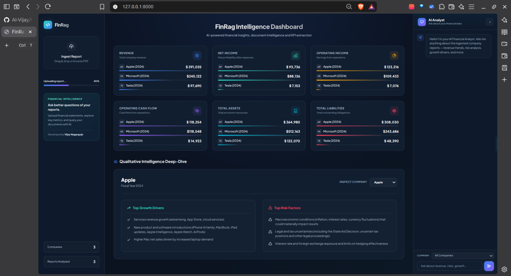
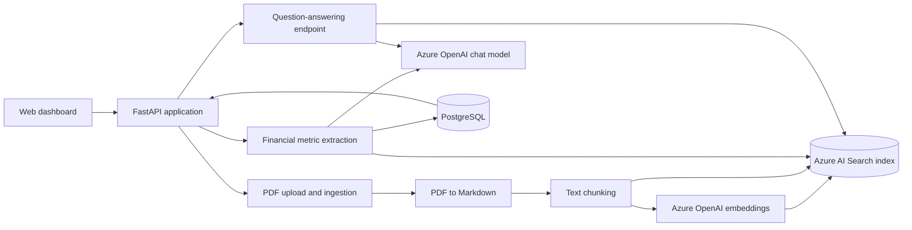

# FinRag

### AI-Powered Financial Document Intelligence

**Developer:** Vijay Nagargoje

FinRag is a Python and FastAPI application for exploring corporate annual reports. It processes PDF documents, indexes report content in Azure AI Search, extracts financial information with Azure OpenAI, and stores extracted metrics in PostgreSQL. A web dashboard provides access to document uploads, financial metrics, and question answering.


## Preview

### Financial Intelligence Dashboard

FinRag displays financial KPIs for uploaded annual reports, including revenue, net income, operating income, cash flow, assets, and liabilities. It also highlights growth drivers and risk factors.


### PDF Report Upload

Upload a financial report through the dashboard. The interface displays upload progress while the document is submitted for processing.



### AI-Powered Financial Q&A

Ask questions about the indexed reports through the AI Analyst panel. The example below illustrates how the assistant responds when it cannot find sufficient supporting context for a question about NVIDIA.


> **Note:** The screenshots show a locally running application with sample financial-report data. The AI Analyst can provide incomplete answers when relevant documents are missing or not retrieved; always verify financial figures against source reports.

## What FinRag Does

- **PDF ingestion:** Accepts financial report PDFs through the upload API.
- **Document preparation:** Converts PDF content to Markdown and divides it into searchable chunks.
- **Indexing:** Generates Azure OpenAI embeddings and stores report text, metadata, and vectors in Azure AI Search.
- **Financial information extraction:** Uses report context and Azure OpenAI to extract financial metrics and related information.
- **Metric persistence:** Stores extracted financial data in PostgreSQL.
- **Document Q&A:** Retrieves indexed report text and supplies it to an Azure OpenAI chat model to answer questions.
- **Dashboard:** Serves a web interface using Jinja2, HTML, CSS, and JavaScript.

**Important:** AI-generated answers and extracted figures can be incorrect. Check material figures against the original annual report before relying on them.

## Architecture




## Technology Stack

| Component | Technology |
| --- | --- |
| API server | Python 3.12+, FastAPI, Uvicorn |
| Web interface | Jinja2, HTML, CSS, JavaScript |
| Document processing | PyMuPDF4LLM and project ingestion modules |
| Language model and embeddings | Azure OpenAI |
| Search and document index | Azure AI Search |
| Structured data | PostgreSQL, SQLAlchemy, psycopg2 |
| Configuration and dependencies | `.env`, python-dotenv, UV, `requirements.txt` |
| Deployment assets | Dockerfile, Kubernetes manifests, GitHub Actions workflow (included, not deployment-verified yet) |

## Repository Overview


```text
FinRag/
├── app.py
├── config/
│   └── settings.yaml
├── database/
├── ingestion/
├── llm/
├── rag/
├── routes/
├── vectorstore/
│   └── create_index.py
├── templates/
│   └── dashboard.html
├── static/
│   └── style.css
├── data/
│   ├── raw_pdfs/
│   └── markdown/
├── requirements.txt
├── dockerfile
├── k8s/
└── .github/workflows/
```

## Prerequisites

- Python 3.12 or later
- [UV package manager](https://docs.astral.sh/uv/)
- A running PostgreSQL server and suitable database credentials
- Azure OpenAI chat and embedding deployments
- An Azure AI Search service with permission to create and populate an index
- Network access to the configured Azure resources

## Local Installation

### 1. Clone the repository

```bash
git clone https://github.com/AI-Vijay/FinRag.git
cd FinRag
```

If your repository has a different URL or directory name, adjust these commands accordingly.

### 2. Install UV

**Linux / macOS**

```bash
curl -LsSf https://astral.sh/uv/install.sh | sh
```

**Windows (PowerShell)**

```powershell
powershell -ExecutionPolicy ByPass -c "irm https://astral.sh/uv/install.ps1 | iex"
```

Verify:

```bash
uv --version
```

### 3. Create an environment and install dependencies

```bash
uv venv --python 3.12
uv pip install --python .venv/bin/python -r requirements.txt
```

On Windows, use `uv pip install --python .venv\Scripts\python.exe -r requirements.txt` instead. Alternatively, activate the environment and run `uv pip install -r requirements.txt`.

### 4. Configure credentials

Create `.env` in the project root and populate it with the variables **actually read by your project's code**. The names below are reproduced from the supplied rebranded README and **must be checked against the current configuration loader** before use.

```dotenv
# PostgreSQL
POSTGRES_HOST=localhost
POSTGRES_PORT=5432
POSTGRES_USER=postgres
POSTGRES_PASSWORD=YOUR_POSTGRES_PASSWORD
POSTGRES_DATABASE=investor_intelligence

# Azure OpenAI (example naming convention; verify in code)
AZURE_OPENAI_ENDPOINT=https://YOUR_RESOURCE.openai.azure.com/
AZURE_OPENAI_API_KEY=YOUR_AZURE_OPENAI_KEY
AZURE_OPENAI_API_VERSION=YOUR_SUPPORTED_API_VERSION
AZURE_OPENAI_CHAT_DEPLOYMENT=YOUR_CHAT_DEPLOYMENT
AZURE_OPENAI_EMBEDDING_DEPLOYMENT=YOUR_EMBEDDING_DEPLOYMENT

# Azure AI Search (example naming convention; verify in code)
AZURE_SEARCH_ENDPOINT=https://YOUR_SEARCH_SERVICE.search.windows.net
AZURE_SEARCH_API_KEY=YOUR_SEARCH_ADMIN_KEY
AZURE_SEARCH_INDEX_NAME=investor-intelligence-v2
```

> **Configuration warning:** Some project versions use separate chat/embedding endpoint and key variables rather than the shared Azure OpenAI variables above. Use the exact variable names and endpoint formats required by the checked-in code; do not mix the two schemes.

### 5. Prepare PostgreSQL and Azure AI Search

Ensure PostgreSQL is running and accepts the configured credentials. The supplied README says the application attempts to initialize its database and search index on startup; confirm successful initialization in the logs.

For Azure AI Search, the supplied index definition contains these fields:

| Field | Purpose |
| --- | --- |
| `id` | Unique document key |
| `company` | Company metadata |
| `year` | Report year metadata |
| `source_file` | Source PDF metadata |
| `content` | Searchable document text |
| `content_vector` | Stored embedding vector |

The supplied index configuration specifies **1536 dimensions** for `content_vector`. This must match the embedding model's output dimensions. The index also specifies an HNSW algorithm configuration (`hnsw-config`) and vector profile (`vector-profile`). Creating the index does not automatically index PDFs; documents must still be ingested.

### 6. Start the application

```bash
uv run --no-project uvicorn app:app --host 127.0.0.1 --port 8000
```

If the installed UV version or project setup does not support that command, activate the virtual environment and run:

```bash
uvicorn app:app --host 127.0.0.1 --port 8000
```

| Page | Local URL |
| --- | --- |
| Dashboard | http://127.0.0.1:8000/ |
| Interactive API documentation | http://127.0.0.1:8000/docs |
| Health endpoint | http://127.0.0.1:8000/health |

The API may start even if search-index initialization fails. Check startup logs rather than assuming all dependencies are healthy.

## API Reference

Endpoints below are based on the supplied README, not independently re-tested against the source code.

| Method | Endpoint | Description |
| --- | --- | --- |
| `GET` | `/` | Dashboard |
| `GET` | `/health` | Application health response |
| `GET` | `/api/metrics` | Stored financial metrics |
| `POST` | `/api/upload` | Upload and process a PDF |
| `POST` | `/api/chat` | Ask a question about indexed report content |

### Upload a report

```bash
curl -F "file=@data/raw_pdfs/2024_Tesla.pdf" \
  http://127.0.0.1:8000/api/upload
```

This example requires the named PDF to exist locally. The supplied README reports filename-based metadata parsing using names such as `2024_Tesla.pdf`.

### Ask a question

```bash
curl -X POST http://127.0.0.1:8000/api/chat \
  -H 'Content-Type: application/json' \
  -d '{"question":"What was Tesla revenue in 2024?","company":"Tesla","year":2024}'
```

Confirm the request schema in `/docs`, especially the accepted data type for `year`, before integrating a client.


## Troubleshooting

| Issue | What to check |
| --- | --- |
| PostgreSQL connection failure | Service status, host, port, credentials, database and SSL settings |
| Azure AI Search DNS or connection error | Search service endpoint and network connectivity |
| Index schema or algorithm conflict | Existing index definition; use a new index name if migration is required |
| Embedding/vector error | Deployment name, API version and vector dimension agreement |
| Upload takes too long | PDF parsing/OCR, document size, Azure latency and server logs |
| Chat produces no useful answer | Index contents, metadata, text retrieval and chat deployment |
| Missing metrics | Extraction logs, database writes and source report content |

**Local PostgreSQL note:** The supplied README reports `sslmode=require` in `database/postgres_sql.py`. If your local server does not support SSL, verify and adapt that connection setting for development. Keep secure transport enabled for remote production databases.

## Security and Current Limitations

- Keep `.env` out of version control; use a `.gitignore` rule and rotate any credentials previously exposed.
- The supplied documentation does **not** establish authentication, role-based access, or other production security controls.
- Query-time retrieval is currently described as **keyword-based**, even though document embeddings are stored.
- Uploaded documents may contain confidential data. Check data-handling requirements before using sensitive reports with cloud services.
- Financial outputs are informational and require independent verification.
- Docker, Kubernetes, and CI/CD files are described as present, but successful production deployment has not been verified.

## Deployment

The supplied README references a Dockerfile, Kubernetes manifests in `k8s/`, and a GitHub Actions workflow in `.github/workflows/`, plus `CICD_Deployment_Guide.md` and `deployment-Document.md`. Review these files and test the deployment workflow before advertising a production deployment. No working cloud deployment is claimed here.

## Developer

**Vijay Nagargoje**  
**Project:** FinRag  
**Focus:** Financial document intelligence, FastAPI, Azure OpenAI, Azure AI Search, and PostgreSQL

---

*FinRag helps turn complex financial reports into searchable, explorable information.*
